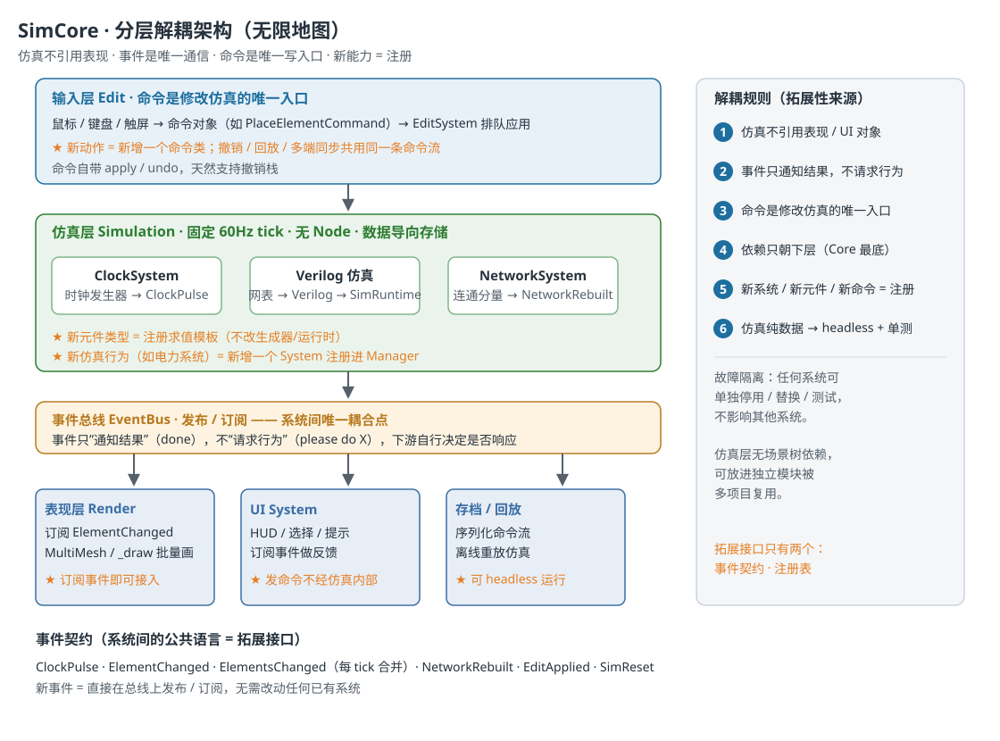
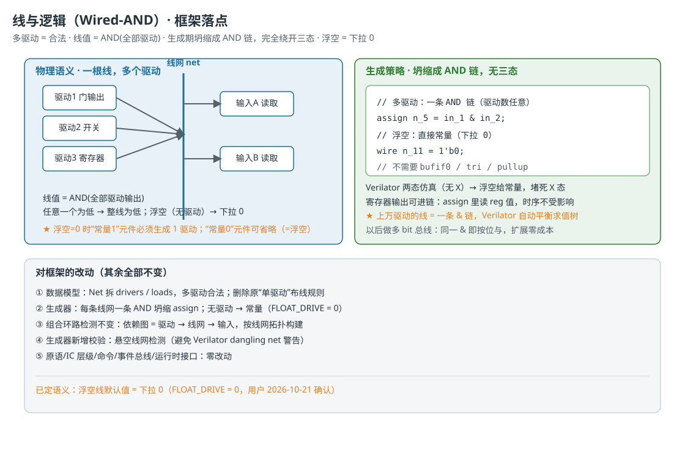

# 无限地图・电路仿真框架设计文档（SimCore + Verilog 化仿真）


* 版本：v1.0

* 日期：2026-10-21

* 状态：设计稿（待落地）

* 适用引擎：Godot 4.6（GDScript 示意代码均为设计说明，非交付实现）


***

## 1. 背景与目标

《无限地图》是电路逻辑模拟类游戏。地图上可能有**上万个电路元件**，由时钟发生器驱动。逐元件模拟方式在万级规模下帧率跌至 40 FPS，无法满足规模需求。

本框架（代号 **SimCore**）以「系统互相独立、解耦、高拓展性」为第一目标，并将仿真核心迁移到 **Verilog 化**方案：

> 电路（网表）→ 生成 Verilog 代码 → 模拟时运行编译后的 Verilog 模型，而非逐元件模拟。
> 游戏与模型之间的数据交换只发生在 
>
> **I/O 边界部件**
>
> （开关 / 灯 / 探针）。

### 1.1 设计目标（硬约束）


| # | 约束                             | 收益                       |
| - | ------------------------------ | ------------------------ |
| 1 | 仿真层零 Node、纯数据（数组 / 结构体，数据导向存储） | 可 headless 运行、可单测、可跨项目复用 |
| 2 | 系统间唯一通信通道是事件总线                 | 解耦；单个系统可停用 / 替换 / 测试     |
| 3 | 表现层只读；修改仿真的唯一入口是命令             | 可控、可撤销、可回放、可多端同步         |
| 4 | 新系统 / 新元件 / 新命令 = 注册           | 开闭原则，拓展性来源               |

### 1.2 关键决策记录


| 决策点        | 结论                                                    |
| ---------- | ----------------------------------------------------- |
| 仿真方式       | 电路 → 生成 Verilog → 运行编译后模型；不逐元件模拟                      |
| 与游戏世界的数据交换 | 只发生在 I/O 边界部件（开关 = 输入、灯 / 探针 = 输出）                    |
| 线网语义       | **线与逻辑（Wired-AND）**：线值 = AND (全部驱动)，**多驱动合法**         |
| 浮空线默认值     | **下拉 0**（生成器常量 `FLOAT_DRIVE = 0`，已确认）                 |
| 自定义集成电路    | `CircuitDef` → Verilog 子模块实例化，支持**任意深度嵌套**            |
| 元件 / 引脚    | 元件尺寸**不固定**；引脚 = 基于元件原点的 `offset` + `dir`             |
| 时钟所有权      | 游戏拥有 clk；模型是被测设备（DUT），不是自走时钟                          |
| 仿真后端       | Verilator（GDExtension，推荐）/iverilog（离线调试）/ 内置参考解释器（原型） |


***

## 2. 总体架构




### 2.1 分层职责


| 层                | 职责                                    | 关键规则                    |
| ---------------- | ------------------------------------- | ----------------------- |
| 核心 Core          | SystemManager / EventBus / TickDriver | 依赖最底层，其余层只朝下层依赖         |
| 仿真层 Simulation   | 网表（源真值）、Verilog 生成、SimRuntime         | 无 Node、纯数据、固定 60Hz tick |
| 编辑层 Edit         | 输入 → 命令对象 → 排队应用                      | 命令是修改仿真的唯一入口            |
| 事件总线 EventBus    | 发布 / 订阅                               | 系统间唯一耦合点；事件只通知结果        |
| 表现层 Presentation | Render / UI / 存档回放                    | 只订阅事件，只读，不碰仿真内部         |

### 2.2 解耦规则（拓展性来源）


1. 仿真不引用任何表现 / UI 对象。

2. 事件只「通知结果」（done），不「请求行为」（please do X），下游自行决定是否响应。

3. 命令是修改仿真的唯一入口。

4. 依赖只朝下层（Core 最底）。

5. 新系统 / 新元件 / 新命令 = 注册。

6. 仿真纯数据 → headless + 单元测试。


***

## 3. 核心机制

### 3.1 固定逻辑 Tick（与渲染解耦）

仿真固定在 60Hz 逻辑节拍，与渲染帧率完全无关（参照 Factorio 的 60 UPS）。渲染掉帧不会让电路变快 / 变慢，逻辑开销也不再拖累渲染帧率。


```
# 示意：TickDriver（挂场景的 Node）
const TICK := 1.0 / 60.0
var _acc := 0.0

func _process(delta: float) -> void:
    _acc += delta
    _acc = minf(_acc, TICK * 3.0)   # 掉帧时最多追 3 拍，防止雪崩
    while _acc >= TICK:
        manager.tick(TICK)          # 电路仿真只在这里跑
        _acc -= TICK
```

### 3.2 仿真演进：逐元件求值 → Verilog 化


| 维度        | 旧方案（逐元件）           | 新方案（Verilog 化）                         |
| --------- | ------------------ | -------------------------------------- |
| 每 tick 成本 | O (元件数)，万级时 40 FPS | O (编译一次 + I/O 交换)，仿真开销移出游戏循环           |
| 内部元件      | 逐个求值（脏队列）          | 编译后模型整体求值（Verilator 单线程约 100× 于解释型仿真器） |
| 新增元件类型    | 写求值函数              | 注册 Verilog 表达式模板                       |
| 自定义 IC    | 自实现展平 / 复用         | Verilog 模块层级天然支持嵌套                     |

**网表是唯一源真值，Verilog 只是编译产物**：编辑层永远操作网表，不碰 Verilog；生成 / 编译全部后台化。


***

## 4. 数据模型


```
# 示意：网表核心结构（CircuitModel）
enum PinDir { IN, OUT, INOUT }

class PinDef:            # 引脚定义（挂在元件/IC 定义上）
    var name: StringName # → Verilog 端口名
    var dir: PinDir      # 电气方向：IN / OUT / INOUT
    var offset: Vector2i # 相对元件原点(左上)的格点偏移
    var edge: int        # 几何出线方向：0=N 1=S 2=E 3=W

class DeviceDef:         # 元件定义（原语或自定义 IC，可复用）
    var id: StringName
    var size: Vector2i   # 尺寸不固定
    var pins: Array[PinDef]

class DeviceInstance:    # 地图上的一个实例
    var uid: int
    var def_id: StringName
    var pos: Vector2i    # 元件原点(左上)世界坐标
    var rotation: int    # 0/90/180/270，引脚 offset 随旋转变换
    var pin_net := {}    # pin_name -> net_id

class Net:               # 线网：线与逻辑核心 —— 多驱动合法
    var id: int
    var drivers := []    # 输出引脚列表（可多条，线与）
    var loads := []      # 输入引脚列表（可多个读取）
```

### 4.1 引脚模型（offset + dir）


* `offset`：引脚相对元件原点（左上角）的格点偏移，决定引脚在元件上的几何位置；

* `dir`：电气方向（IN/OUT/INOUT），决定其在 Verilog 中作为端口 / 输入 / 输出的角色；

* `edge`：导线出线方向（N/S/E/W），供绘制与路由使用；

* 元件旋转时：`引脚世界坐标 = pos + offset.rotated(rotation)`（90/180/270 用整数四向变换表，不引入浮点）；

* **元件定义与地图实例分离**：定义（含 size + 引脚表）可复用，实例只存位置 / 朝向 —— 这是自定义 IC 复用的基础。

### 4.2 接线规则


* 输出引脚 → `net.drivers`（一条线网可挂**任意多个**输出，线与语义）；

* 输入引脚 → `net.loads`（一条线网可被**任意多个**输入读取）；

* 原有「一个输出只挂一条线」的布线限制**删除**（线与使多驱动合法）。


***

## 5. 线与逻辑（Wired-AND）语义




### 5.1 定义


```
线网值 = AND(全部驱动输出)
任意驱动为低 → 整线为低
无驱动（浮空）→ 下拉 0（FLOAT_DRIVE = 0，已确认）
```

### 5.2 推论（由「浮空 = 下拉 0」导出）


| 推论      | 说明                                          |
| ------- | ------------------------------------------- |
| 常量 1 元件 | **必须生成 1 驱动**（主动拉高，压过下拉）—— 与「上拉 1」约定的省略优化不同 |
| 常量 0 元件 | 生成 0 驱动即可（与浮空等价，也可省略）                       |
| 多驱动     | 合法且是常态（开关矩阵、二极管逻辑、按钮线网的典型用法）                |
| 三态原语    | 完全不需要：`bufif0 / tri / pullup` 全部避开          |

### 5.3 Verilog 生成（AND 坍缩）

线与逻辑在**生成期坍缩**成 AND 链，这是绕开三态的关键：


```
// 示意：生成器输出（FLOAT_DRIVE = 0）
module top(
    input  clk,
    input  in_1, in_2, in_3,
    output out_7, out_8, out_9, out_10
);
    reg   q_6;
    wire  n_5;                  // 两个开关线与
    assign n_5 = in_1 & in_2;
    wire  n_2;
    assign n_2 = ~in_3;         // 组合门（NOT）
    wire  n_7;
    assign n_7 = n_5 & n_2;     // AND 门
    wire  n_9;
    assign n_9 = q_6;           // 寄存器输出进链
    wire  n_11 = 1'b0;          // 浮空 = 下拉 0
    always @(posedge clk) q_6 <= n_7;   // D 触发器
    assign out_7 = n_5;
    assign out_8 = n_7;
    assign out_9 = n_9;
    assign out_10 = n_11;
endmodule
```

要点：


* 每条线网一条 `assign`（AND 链，驱动数任意，上万驱动也只是一条链，Verilator 编译期自动平衡求值树）；

* 无驱动的线网直接给常量（两态仿真无 X，浮空必须有定义值，常量正好堵死 X 态）；

* 寄存器输出（`reg`）可直接参与 AND 链，时序不受影响；

* 未来多 bit 总线：同一 `&` 即按位与，扩展零成本；

* 生成器须做**悬空线网检测**（避免 Verilator dangling-net 警告）。


***

## 6. 运行时：SimRuntime（后端可插拔）


```
# 示意：运行时抽象接口
class_name SimRuntime
extends RefCounted

func load(vlog: String, top: StringName) -> Error: pass   # 编译并加载
func set_input(pin: StringName, value: bool) -> void: pass
func eval() -> void: pass                                  # 组合逻辑 settle
func pulse_clk() -> void: pass                             # 0→1→0（有寄存器时）
func read_output(pin: StringName) -> bool: pass
func reset() -> void: pass
```

### 6.1 后端选型


| 后端                              | 用途              | 说明                                                                |
| ------------------------------- | --------------- | ----------------------------------------------------------------- |
| **Verilator → GDExtension dll** | 游戏内运行（推荐）       | 编译型；单线程约 100× 于 Icarus，10–100× 于事件驱动仿真器；支持线程并行；C++ 模型封装成 Godot 扩展 |
| Icarus Verilog                  | 离线调试 /testbench | 解释型，只用于开发期验证，不适合每 tick 跑                                          |
| 内置参考解释器                         | 原型期兜底           | 实现两态固定点求值，作为 Verilator 后端的真值对照，之后可弃                               |

### 6.2 三态与两态注意事项（Verilator）


* Verilator 只把「简单三态结构」转成两态，内部三态支持限制多（inout 处理、总线需整体处理、函数内不支持）；

* AND 坍缩方案**与三态彻底无关**，天然规避这些限制；

* Verilator 是**两态仿真（无 X）**，未知值随机化 —— 因此浮空线必须有定义值（本项目：下拉 0）。


***

## 7. 更新循环与 I/O 边界


```
# 示意：每个逻辑 tick
func _sim_tick() -> void:
    if netlist_dirty:
        _rebuild_async()        # 后台：生成 Verilog → 哈希缓存 → 编译 → 原子切换
        netlist_dirty = false
    runtime.sync_inputs(world)  # 只有 I/O 边界部件参与数据交换
    runtime.eval()              # 组合逻辑 settle
    if has_registers: runtime.pulse_clk()
    for pin in runtime.changed_outputs():
        bus.emit(&"ElementChanged", {...})
```


* `_rebuild_async()`**&#x20;= 后台线程 + 原子切换**：编译期间旧模型继续跑，不丢帧；完成后主线程换指针；

* **编译缓存**：网表按哈希缓存；自定义 IC 定义单独缓存，顶层小改只重编顶层（秒级）；

* 游戏与模型的**唯一数据接口 = 边界 I/O 部件**：开关（写输入）、灯 / 探针（读输出）；内部元件不参与逐元件交换。


***

## 8. 系统划分与事件契约

### 8.1 系统表（每个独立、可替换）


| 系统            | 职责                        | 输入          | 输出事件             |
| ------------- | ------------------------- | ----------- | ---------------- |
| ClockSystem   | 时钟发生器                     | —           | ClockPulse       |
| Verilog 仿真系统  | 网表 → Verilog → SimRuntime | 时钟脉冲 / 编辑命令 | ElementChanged   |
| NetworkSystem | 连线后连通分量（增量重算）             | EditApplied | NetworkRebuilt   |
| EditSystem    | 输入 → 命令 → 应用              | 命令          | EditApplied      |
| RenderSystem  | 只读订阅 + 批量渲染               | 事件          | —                |
| UiSystem      | HUD / 选择 / 提示             | 事件          | 命令（经 EditSystem） |
| SaveSystem    | 序列化命令流                    | 事件          | SimReset         |

### 8.2 事件契约

`ClockPulse` · `ElementChanged` / `ElementsChanged`（每 tick 合并）・`NetworkRebuilt` · `EditApplied` · `SimReset`

新事件 = 直接在总线上发布 / 订阅，无需改动任何已有系统。

### 8.3 命令模式（编辑层 → 仿真层）


```
# 示意：命令对象，一个类一个动作
class PlaceElementCommand:
    var element_type: StringName
    var pos: Vector2i
    func apply(ctx): ctx.place_element(element_type, pos)
    func undo(ctx):  ctx.remove_element_at(pos)
```

命令是**修改仿真的唯一入口**，因此撤销、回放、联机同步共用同一套机制，UI 完全不感知仿真内部结构。


***

## 9. 风险与对策


| 风险               | 对策                                          |
| ---------------- | ------------------------------------------- |
| 组合环路（无寄存器反馈）     | 生成前拓扑检测（依赖图 = 驱动→线网→输入），报出环路路径给玩家           |
| 编译延迟（编辑频繁时）      | 哈希缓存 + 后台编译 + 原子切换；IC 库独立缓存                 |
| 浮空线 X 态（两态仿真无 X） | 浮空给常量（下拉 0），由生成器统一处理                        |
| 悬空线网             | 生成器校验，避免 Verilator dangling-net 警告          |
| 寄存器初值            | 统一 `reset` 端口，上电 / 放置元件时复位，避免状态未知           |
| 多时钟发生器           | v1 约定单全局 clk 端口；多时钟域作为后续扩展（多 clk 端口 + 使能信号） |


***

## 10. 路线图（落地切片）


| 切片 | 内容                                                       | 交付物               |
| -- | -------------------------------------------------------- | ----------------- |
| S1 | 数据模型（Pin/Device/Net/CircuitModel）+ Verilog 生成器 + 内置参考解释器 | 可跑的骨架 + 演示电路与期望校验 |
| S2 | 核心框架：EventBus / SystemManager / TickDriver / 命令模式        | 系统注册与启停、固定 tick   |
| S3 | 嵌套自定义 IC：CircuitDef 层级生成 + IC 库哈希缓存                      | 子模块实例化、任意深度嵌套     |
| S4 | Verilator GDExtension 后端 + 后台编译 / 原子切换                   | 万级元件满帧运行          |
| S5 | 编辑系统（放置 / 删除 / 连线命令 + 撤销）+ 存档回放                          | 完整可玩闭环            |


***

## 11. 参考来源


* Factorio 官方博客：FFF-18（缓存局部性：能量网络更新～30ms → \~10ms）、FFF-421（Optimizations 2.0：实体睡眠、Roboport 更新 1ms → 0.025ms/tick、多线程与内存吞吐瓶颈）


  * [https://factorio.com/blog/post/fff-18](https://factorio.com/blog/post/fff-18)

  * [https://www.factorio.com/blog/post/fff-421](https://www.factorio.com/blog/post/fff-421)

* Factorio 机制分析：固定 60 UPS 与渲染解耦、实体睡眠、数据导向


  * [https://simstructures.com/factorio-under-the-hood/](https://simstructures.com/factorio-under-the-hood/)

* Factorio 电路网络（Wiki / 论坛「优化空闲电路网络」：网络睡眠、状态变化唤醒实体）


  * [https://wiki.factorio.com/Circuit\_network](https://wiki.factorio.com/Circuit_network)

  * [https://forums.factorio.com/viewtopic.php?f=6\&t=68966](https://forums.factorio.com/viewtopic.php?f=6\&t=68966)

* Verilator 官方文档：性能（单线程～100× 于 Icarus）、三态 / 两态限制、编译选项


  * [https://www.veripool.org/verilator/](https://www.veripool.org/verilator/)

  * [https://verilator.org/guide/latest/simulating.html](https://verilator.org/guide/latest/simulating.html)

  * [https://verilator.org/guide/latest/languages.html](https://verilator.org/guide/latest/languages.html)

  * [https://verilator.org/guide/latest/faq.html](https://verilator.org/guide/latest/faq.html)