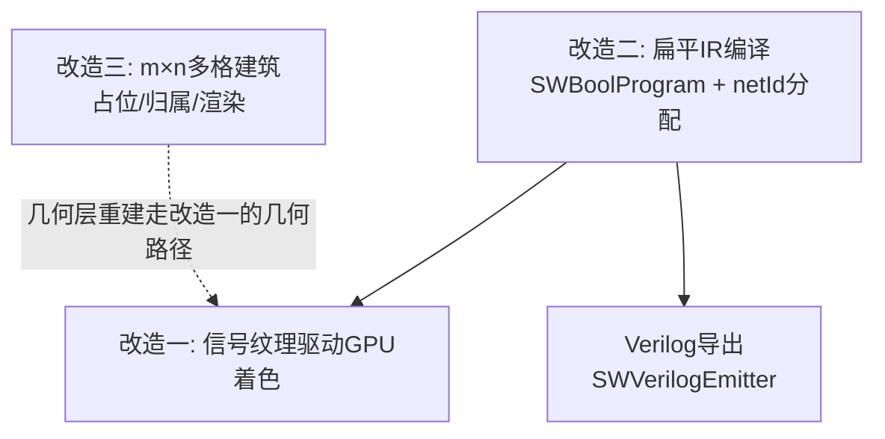
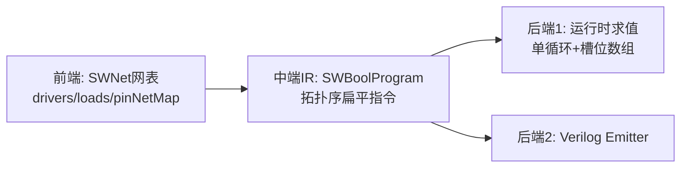
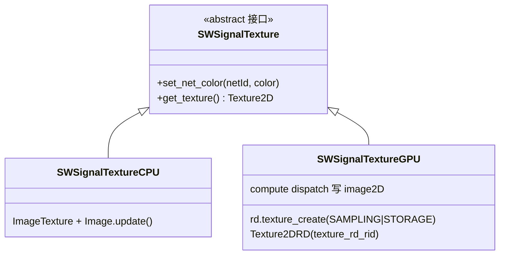
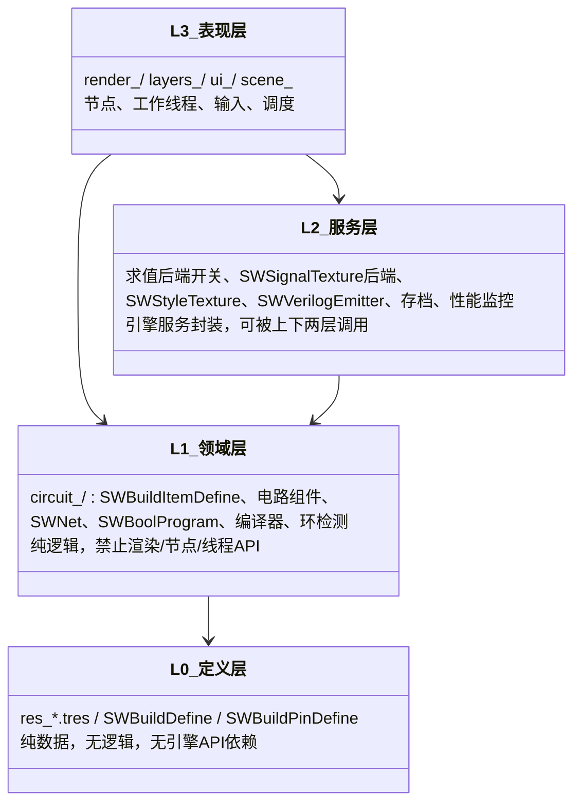

# 无限地图 · 三大重构技术方案与任务排期

> 版本：v1.0（2026-10-16）
> 范围：① 信号计算与渲染解耦（CPU 只算信号 → GPU 重绘）；② 电路转扁平代码（IR）+ Verilog 导出；③ m×n 多格建筑。
> 约定：本文档只做设计与排期，不附带任何代码改动；所有任务由开发者按里程碑逐个实施。

---

## 0. 总览

### 0.1 三项改造的关系

- **改造二是地基**：拓扑变化时的"编译期"钩子（netId 分配、拓扑序、寄存器屏障）同时被改造一（渲染）和 Verilog 导出复用。
- **改造一**把高频路径（时钟 tick）从"整块 MultiMesh 重建"降为"写一个 texel"。
- **改造三**改动面最广（占位/归属/渲染/交互/存档），放在最后，且其几何渲染直接走改造一后的几何层路径。

### 0.2 推荐实施顺序

| 顺序 | 改造 | 理由 |
|---|---|---|
| 1 | 改造二（IR） | 纯逻辑层改动，风险最低、可独立用 GUT 回归验证；同时产出 Verilog，且为改造一提供 netId/编译钩子 |
| 2 | 改造一（GPU 着色） | 依赖改造二的 netId；解决当前最大性能瓶颈（时钟驱动全量重绘） |
| 3 | 改造三（m×n） | 依赖前两项稳定后的几何层接口；改动面大，需要前两项的回归基线 |

### 0.3 详细规格文档（交给 AI 实施时以下列 SPEC 为准）

| 文档 | 覆盖任务 | 里程碑 |
|---|---|---|
| [`docs/specs/SPEC-02-IR与Verilog.md`](specs/SPEC-02-IR与Verilog.md) | T2.1~T2.7：op分派 / netId / SWBoolProgram / 编译集成 / getValue切换 / Emitter / iverilog回环 | M1~M3、M6 |
| [`docs/specs/SPEC-01-信号纹理渲染.md`](specs/SPEC-01-信号纹理渲染.md) | T1.1~T1.7：styleTex / signalTex / shader / calBuffer / tick切换 / 验收；附 T1.8~T1.10 compute后端 | M4~M5、M9 |
| [`docs/specs/SPEC-03-mxn建筑.md`](specs/SPEC-03-mxn建筑.md) | T3.1~T3.8：footprint / occupancy / 影子chunk / 引脚探测 / 铺格渲染 / 交互 / 存档 | M7~M8 |

每份 SPEC 均含：现状代码锚点（含行号，实施前需重核）、新类型与函数签名、集成点、逐步骤改动清单、验收标准（含具体测试命令/脚本）、回退方案、禁区。

### 0.4 AI 实施规约（每个会话开始时必须遵守）

1. **范围隔离**：每个任务只改 SPEC 列出的文件；改到范围外文件必须停下说明。
2. **验证门禁**：每完成一个 T 任务，先跑 GUT 全量：`godot --headless -d -s addons/gut/gut_cmdln.gd -gdir=res://test -gexit`（以 `.gutconfig.json` 为准），全绿才算完；渲染类任务另跑像素回归（SPEC-01 §3）。
3. **指标留痕**：性能相关任务前后数据写入 `docs/metrics.md`（getRenderParts 调用数 / drawMap 次数 / EvalStruct 耗时 / 帧率）。
4. **禁止事项**：不在既有枚举中间插值；不引入每帧 new 字典/数组的热路径分配；工作线程内禁触 Resource；不重写隧道/交叉的旋转补偿既有约定。
5. **回退优先**：凡切换型改造（useIR、后端选择）必须带单开关回退，回退路径与主路径同受测试保护。
6. **对拍安全网**：M2 对拍（IR vs 树）与 M4 像素回归未过，禁止进入下游任务。
7. **顺序**：严格按里程碑 M1→M9；SPEC 内任务编号即实施顺序。
8. **分层归属（强制）**：新增/修改代码前，先在 §5 分层架构中确认目标层；跨层引用按 §5.3 依赖规则判定，违例即停下说明。
9. **扩展优先**：加功能/修 bug 时优先在既有端口/事件上扩展（见 §5.4 接口清单），禁止为单个功能在多个层里同时开洞；新功能先在 SPEC/文档补一段设计再动代码。
10. **开闭原则（强制）**：加元件/后端/导出格式/尺寸/存档字段，按 §5.6 扩展表的标准接法做（新增子类/后端/数据，不改核心流程）；在任何核心 match/if-else 链里插入类型特判前必须停下说明。

### 0.5 现状关键文件索引

| 模块 | 文件 | 职责 |
|---|---|---|
| 建筑定义 | `res/sw_build_define.gd` | SWBuildDefine（图集、引脚、元件类型）；**单格，无 size 字段** |
| 建筑实例 | `circuit/build/sw_build_item_define.gd` | buildAxisPos（单点）、rotation、组件容器 |
| 建筑管理 | `circuit/build/sw_build_manager.gd` | chunkMap / buildStoreManager；**单格占用** |
| 区块数据 | `render/sw_draw_chunk_data.gd` | builds 固定 CHUNK_SIZE² 槽位 + notNullBuilds |
| 绘制调度 | `core/manager/sw_draw_manager.gd` | updataChunks / _refreshChunkContent / drawMap |
| 渲染节点 | `render/sw_multi_mesh_instance_2d.gd` | calBuffer 线程、双缓冲、_fill_instance |
| 着色器 | `render/sw_grid_draw.gdshader` | custom_data=图集rect，COLOR=乘法混色 |
| 电路网络 | `circuit/sw_net.gd` | SWNet：curSignal、_drivers/_loads、wireGroup |
| 电路控制 | `circuit/sw_cirucit_control.gd` | updateBuildCircuit / buildSignalChanged / noticeMap |
| 电路组件 | `circuit/build_compoent/sw_build_compoent_circuit*.gd` | 表达式构建（And/NotAnd/Equal）、getValue |
| 表达式求值 | `com/sw_common.gd` | EvalStruct（epoch memo）、AndValues 等 Callable |
| 建筑层 | `layers/build/sw_build_layer.gd` | 时钟 _process、getNotifyChunkPosArr、放置/删除 |
| 图集 | `atlas/sw_atlas.gd` | 当前图集纹理（4 张可切换） |

---

## 1. 改造二：电路转扁平代码（IR）+ Verilog 导出

> 详细规格见 [`docs/specs/SPEC-02-IR与Verilog.md`](specs/SPEC-02-IR与Verilog.md)。
> 建议最先做。目标：① 消除求值热路径的 Callable 派发/递归/类型判断；② 产出可仿真的 Verilog。
> 注意：现 EvalStruct 已有 epoch memo，复杂度是 O(触及节点)，优化对象是**每节点常量开销**，不是复杂度。

### 1.1 目标架构

### 1.2 IR 设计（SWBoolProgram）

- 指令四元组：`op[i], dst[i], a[i], b[i]`，全部 `PackedInt32Array`；求值缓冲 `_slots` 复用不重分配。
- 操作码集合（当前门类型足够）：`OP_INPUT`（源/引脚电平）、`OP_LATCH`（寄存器 Q，时序屏障）、`OP_AND`、`OP_NAND`、`OP_PASS`（Equal 直通）、`OP_NOT`。预留 `OP_OR/OP_XOR`。
- 编译时机：`updateBuildCircuit`（拓扑变化）末尾一次性编译；信号 tick **不重编译**。
- 关键规则：
  - **扇出去重**：`node → slotIdx` 字典，同一 SWCircuitStruct 节点只占一个 slot（与现 memo 等价，但变成数组下标）。
  - **寄存器屏障**：跨寄存器的反馈边编译为 `OP_LATCH`，保证组合岛无环可拓扑排序（沿用既有"寄存器时序屏障"策略）。
  - **组合环校验**：编译前用既有迭代式 Kosaraju 检查；发现纯组合环 → 报错并列出环路建筑，与游戏内 in_loop 红点同判据。

### 1.3 求值切换（分两步，先低风险）

**步骤 A（过渡，先落地）**：`SWCircuitStruct` 增加 `op:int` 枚举字段，`EvalStruct` 用单一 `match` 直接计算，删除 `optFunc.call` 动态派发与叶子处 `is SWBuildPinStruct/SWCircuitStruct` 类型判断（叶子统一归一化为"读一个 int 输入"）。树结构与 memo 保持不变。

**步骤 B（目标态）**：`getValue(dir)` 改为查询编译后 slot；求值入口从"pull 递归"逐步过渡到"push 传播 + 扁平段重算"：
- 保留 noticeMap BFS 增量调度，只重算"受影响指令段"（利用指令拓扑序保证输入已最新）；
- 门算完直接写 `net.curSignal`（push），最终删除与 setValue 并存的 pull 递归路径。

### 1.4 netId 稳定分配（改造一/二共用）

- `SWNet` 增加 `netId:int`；在 createNets 阶段统一分配（建议按编译批次从 0 递增）。
- 拓扑变化 → 重新分配 netId + 触发改造一的几何层重建（两者同频，天然一致）；两次重建之间 netId 稳定。

### 1.5 Verilog 导出（SWVerilogEmitter）

**产物形态**：先做平坦门级单 module（可仿真可综合），预留层次化实例化开关（AND2/NOT1/DFF 子模块）。

**映射表**：

| 游戏 | IR | Verilog |
|---|---|---|
| SWNet | slot | `wire w_<netId>` |
| 交叉电线 | 两条独立 net | 两条独立 wire |
| 电线桥/隧道 | 同一 net 走线 | 同一 wire |
| 与门/线与 | OP_AND | `assign d = a & b;` |
| 与非门 | OP_NAND | `assign d = ~(a & b);` |
| 非门 | OP_NOT | `assign d = ~a;` |
| 直通 | OP_PASS | `assign d = a;` |
| 1bit 寄存器 | OP_LATCH 屏障 | `always @(posedge clk) q <= d;` |
| 时钟/按钮/开关 | OP_INPUT | `input` 端口 |
| 灯泡 | 输出 | `output` 端口 |
| 悬空输入 | — | 按默认上拉约定补 `1'b0/1'b1` |

**命名规则**（强制）：
- 标识符只用 `build.id`/`netId` + 语义前缀（`w_`、`q_`、`sw_`、`led_`），中文 buildName 只进注释（`// 开关@12,34`）。
- 禁止使用 `CircuitComponentType` 枚举整数参与命名（项目有枚举错位前科）。
- module 名/端口名需合法（字母开头、无冲突）。

**导出前校验**：
1. 组合环：Kosaraju 校验每个组合岛无环，否则拒绝导出并列出环成员。
2. 多驱动：一个 net 的 `_drivers` 数 >1 时——线与语义则显式归约成 `and` 并注释；否则报错。
3. 寄存器初值：Verilog reg 上电为 x；导出时生成 `initial` 或 rst 端口，与游戏上电初值对齐。

**触发方式**：按需导出（菜单/控制台命令），在 IR 编译完成后调用 emitter；**严禁**挂进每 tick 热路径。

### 1.6 验证（金标准）

复用 `CircuitTestHarness` + GUT 增加**回环测试**：
1. 搭建样例电路（含非门链、线与、寄存器、交叉电线）；
2. 引擎内跑 N 个时钟周期，逐拍记录输出端口信号；
3. 导出 .v → `iverilog`（或 verilator）仿真同激励；
4. 逐拍 diff，不一致定位到具体 gate。

### 1.7 任务清单（改造二）

| # | 任务 | 涉及文件 | 验收 | 风险 |
|---|---|---|---|---|
| T2.1 | `SWCircuitStruct` 加 `op:int`；EvalStruct 改 match 单态分派；去除叶子 `is` 判断 | `com/sw_common.gd`、`core/define/sw_define.gd` | 全部 GUT 电路测试通过；性能面板 EvalStruct 耗时下降 | 低 |
| T2.2 | `SWNet` 加 `netId`，createNets 统一分配，拓扑变化重分配 | `circuit/sw_net.gd`、`circuit/sw_cirucit_control.gd` | 存档加载/放置/删除后 netId 连续且稳定 | 低 |
| T2.3 | 实现 `SWBoolProgram`（指令数组 + 槽位求值 + 扇出去重 + LATCH 屏障） | 新文件 `circuit/sw_bool_program.gd` | 与 EvalStruct 双跑对拍：随机电路逐拍结果一致 | 中 |
| T2.4 | 拓扑编译器：updateBuildCircuit 末尾将表达式树编译进 IR；Kosaraju 环校验 | `circuit/sw_cirucit_control.gd` | 放/删/旋后 IR 与树语义等价（对拍通过） | 中 |
| T2.5 | `getValue` 切换 slot 查询；删除 pull 递归（push 写 curSignal） | `circuit/build_compoent/sw_build_compoent_circuit*.gd` | 时钟密集场景帧率提升；GUT 全过 | 高（最后做） |
| T2.6 | `SWVerilogEmitter` 平坦门级版 + 命名/端口表 | 新文件 `circuit/export/sw_verilog_emitter.gd` | 样例电路导出可被 iverilog 编译通过 | 中 |
| T2.7 | iverilog 回环 GUT 测试（含非门链/线与/寄存器/交叉） | `test/circuit/` | 引擎波形 vs Verilog 波形逐拍一致 | 中 |

---

## 2. 改造一：CPU 只算信号 → 信号纹理驱动 GPU 重绘

> 详细规格见 [`docs/specs/SPEC-01-信号纹理渲染.md`](specs/SPEC-01-信号纹理渲染.md)。
>
> 目标：时钟 tick 等高频路径，CPU 只更新"信号纹理"的一个 texel；GPU 逐实例采样着色。彻底移除"整块 MultiMesh 重建"的高频触发。

### 2.1 分层原则

| 变化 | 归层 | 频率 |
|---|---|---|
| 电线/端子高低电平颜色 | **信号层**：改 signalTex 一个 texel | 每 tick（高频） |
| in_loop 红色覆盖 | 几何层 flags | 重分析时（低频） |
| 选中/hover mask | 几何层 COLOR 或独立纹理 | 极低频 |
| HOLDING 半透明 | 几何层 flags/COLOR | 手持（低频） |
| 位置/旋转/图块/连接 | 几何层重建 | 放置删除（低频） |

### 2.2 逐实例数据预算（核心约束）

MultiMesh 提供给 shader 的逐实例数据 = `COLOR(vec4) + INSTANCE_CUSTOM(vec4)` 共 8 个 float，当前已用满（custom=rect 4、color=rgba 4）。需要腾出 `netId` 通道：

**方案 A（推荐）：引入 styleTex 查表**
- `custom_data.x = styleId` → `texelFetch(styleTex, styleId)` 得图集 rect（x,y,w,h）
- `custom_data.y = netId`（<0 表示非信号驱动，用烘焙色）
- `custom_data.z = flags`（in_loop / holding / 备用位）
- `custom_data.w = 备用`
- `COLOR = 烘焙基础色/alpha`（mask、非信号部件）
- `styleTex`：RGBA32F，texel[styleId] = region；构建时扫描所有 `SWBuildDefine.atlas*` 与 `SWBuildPinDefine.wire_pin` 的 region 去重分配 styleId。

**方案 B**：若图集为等分网格，可用 styleId 直接在 shader 内算 rect，省掉 styleTex。需先确认 4 张图集 region 是否等尺寸，不等尺寸必须走 A。

### 2.3 信号纹理（SWSignalTexture）

- 全局单例，RGBA32F，一维当数组（宽 = 最大 net 数，跨行取模）。
- texel[netId] = 该 net **当前显示颜色**（CPU 侧按 wireName 的 low/high 预混好）。
- 电平翻转 → CPU 只调 `set_net_color(netId, color)`；纹理被**所有 chunk 的 ShaderMaterial 共享同一 ImageTexture**，一次 update 全屏生效。
- 采样用 `texelFetch` + NEAREST，避免插值/量化。

### 2.4 渲染管线改造

- **几何层（低频）**：仅内容变化（放置/删除/旋转/连网/in_loop）时走现有 `drawMap → calBuffer` 重建；写入 transform + styleId + netId + flags + 烘焙色。现有双缓冲/工作线程机制保留。
- **信号层（高频）**：时钟 tick / 按钮触发的电平翻转 → **只写 texel，不触发 updataChunks/drawMap**。即 `buildSignalChanged` 收敛后，对 `curSignal` 真变化的 net 调 `set_net_color`。
- **shader 改造**：vertex 取 INSTANCE_CUSTOM；fragment 用 texelFetch 取 rect 与信号色，非信号实例走 COLOR 分支；保留现有 0.5px atlas 防渗色逻辑。

### 2.5 重绘调度变更

- `_process` 时钟路径：删除"changedBuilds → getNotifyChunkPosArr → updataChunks"，改为"收集电平变化的 netId → set_net_color"。
- 内容变化路径保持 `updataChunks → drawMap`（此时 netId 可能重分配，几何层顺带把当前色写入 texel 即可自洽）。
- `getRenderParts` 只保留在几何层路径中调用（配合已有脏标记缓存）。

### 2.6 风险与注意

- **线程约束**：signalTex 更新放主线程（Godot 多线程渲染中 Resource 访问的主线程约束）；calBuffer 工作线程只读几何数据。
- **Web 导出**：本方案只用 fragment 采样纹理，**不依赖 compute shader**，Web/GLES 可用（这是相对"逻辑上 GPU"的关键优势）。
- **netId 溢出**：float 存储取回 `int(x+0.5)`，2^24 内精确，注意上限告警。
- **像素回归**：改造期间用固定种子存档 + 固定相机截图比对，保证非信号像素零变化。

### 2.7 任务清单（改造一）

| # | 任务 | 涉及文件 | 验收 | 风险 |
|---|---|---|---|---|
| T1.1 | styleTex 构建：扫描全部 region 去重分配 styleId，生成查询纹理 | 新文件 `render/sw_style_texture.gd` | 与原 rect 渲染截图逐像素一致 | 低 |
| T1.2 | SWSignalTexture 单例 + set_net_color | 新文件 `core/manager/sw_signal_texture.gd` | texel 读写正确、update 生效 | 低 |
| T1.3 | shader 改造：styleId/netId/flags 采样分支 + 烘焙色回退 | `render/sw_grid_draw.gdshader` | 全部元件（含非门/底座/灯泡/交叉）渲染与改造前一致 | 中 |
| T1.4 | calBuffer 写 custom_data 改为 (styleId, netId, flags, -)；COLOR 改烘焙色 | `render/sw_multi_mesh_instance_2d.gd` | 截图回归通过 | 中 |
| T1.5 | 电平变化路径切换：buildSignalChanged 后只 set_net_color，不触发 chunk 重绘 | `layers/build/sw_build_layer.gd`、`circuit/sw_cirucit_control.gd` | 时钟密集场景：drawMap 调用次数随 tick 不增长；帧率达标 | 中 |
| T1.6 | in_loop/holding/mask 迁入 flags（几何层） | 上述渲染文件 | 环路红点、手持半透明、选中高亮行为不变 | 中 |
| T1.7 | 性能验收：4853 次/tick 级 getRenderParts 调用归零（仅几何层出现） | — | 性能面板对比报告 | — |

### 2.8 可选增强：compute shader 写端（L1/L2）与纹理共用

> 原则：**纹理即接口（ABI）**。渲染端 shader 不变（仍 `texelFetch(signalTex, netId)`），只替换"谁写这张纹理"。改造一（CPU 写纹理版）仍是基线，本节为 M6 之后按需启动的可插拔后端。

#### 后端架构

平台探测：`RenderingServer.get_rendering_device()` 为 null（Compatibility/WebGL2）→ 强制 CPU 后端。**Web 导出必须保留 CPU 回退**。

#### Godot 4 桥接要点（查证）

| 项 | 结论 |
|---|---|
| RD 获取 | `RenderingServer.get_rendering_device()`（主屏 RD；local device 的纹理不能被 canvas 采样） |
| 纹理创建 | `rd.texture_create(RDTextureFormat, RDTextureView)`，usage 含 `SAMPLING_BIT \| STORAGE_BIT` |
| 采样桥接 | Godot 4.2+ `Texture2DRD`，设 `texture_rd_rid` 后可直接作 ShaderMaterial 的 sampler2D |
| 格式 | compute 端 `image2D` format 限定符与 DATA_FORMAT 严格一致（如 `rgba32f`）；注意移动端 RGBA32F storage 支持有限 |
| 帧序 | `_process` 里 compute_list 记录随帧提交，与 canvas 读通常同帧成立；无严格保证时接受 ≤1 帧延迟（电平颜色无感）；严格顺序用 viewport `_render_callback`(PRE_TRANSPARENT) |
| 读写冲突 | 同 pass 不可既 storage 写又 sampler 读；compute 写与 canvas 读跨 pass，天然安全 |

#### L1 vs L2

- **L1（CPU 算信号，compute 仅代写纹理）**：无收益，不采用。CPU 写 texel 已是 O(翻转数) 微拷贝，compute 反增固定提交开销与同步复杂度。
- **L2（compute 直接算信号）**：真正的动机。启动判据：门数 10^5+ 且每帧大面积更新、目标平台支持 RD。

#### L2 设计（双缓冲拓扑分层松弛）

1. net 值：`rgba32f` storage image（双缓冲，逐拍 swap），`texel[netId]=0/1`。
2. gate 列表：RD storage buffer `[opcode, srcA, srcB, dst, level]`；拓扑变化时 CPU 重编码上传。
3. 每帧按拓扑层号迭代 L 遍 dispatch（读 prev 写 next），L=最长链深度。
4. 寄存器：帧边界锁存 `Q <= D_prev`，`OP_LATCH` 读上一份缓冲，组合环天然切断。
5. CPU 仍负责：拓扑重建、Kosaraju 环检测、点击写 input net、`in_loop`/存档/UI **按需批量 readback**（严禁每帧同步）。

#### 任务清单（compute 后端，均在 M6 之后按需启动）

| # | 任务 | 涉及文件 | 验收 | 风险 |
|---|---|---|---|---|
| T1.8 | SWSignalTexture 接口化：抽出 CPU 后端，增加平台探测与后端选择 | `core/manager/sw_signal_texture.gd` | CPU 后端行为与改造一完全一致；Web 平台自动回退 | 低 |
| T1.9 | GPU 后端：RD 纹理创建 + Texture2DRD 桥接 + 空 compute 写入跑通 | 新文件 `render/sw_signal_texture_gpu.gd`、`render/sw_signal_compute.glsl` | 桌面端采样结果与 CPU 后端逐 texel 一致 | 中 |
| T1.10 | L2 信号计算：gate buffer 编码上传 + 分层迭代 + 寄存器帧锁存 + 批量 readback | 同上 + `circuit/` | 与 CPU 求值逐拍对拍一致（复用 M2 对拍框架）；规模场景帧率达标 | 高 |

---

## 3. 改造三：m×n 多格建筑

> 详细规格见 [`docs/specs/SPEC-03-mxn建筑.md`](specs/SPEC-03-mxn建筑.md)。
>
> 现状：建筑单格占用——`SWChunkBuildData.builds` 固定 CHUNK_SIZE² 槽位按单点存取，`buildAxisPos` 单点，`getBuild(axisPos)` 单格查询。m×n 需要贯穿"定义→占位→归属→电路→渲染→交互→存档"七处。

### 3.1 数据模型

- `SWBuildDefine` 增加 `size:Vector2i = Vector2i(1,1)`（逻辑格尺寸，未旋转基准）。
- 实际占地 = 旋转后尺寸：`rotation` 为 90/270 度时 w/h 互换。新增统一函数 `getFootprint(rot) -> Vector2i`。
- `buildAxisPos` 语义固定为**锚点 = footprint 左上角格**。
- 占位表：`SWBuildManager` 增加 `occupancy:Dictionary[Vector2i, int]`（格 → anchor build.id）。放置/删除时按 footprint 写入/清除；`getBuild(axisPos)` 先查 occupancy 再回退单格路径（兼容期）。

### 3.2 区块归属（跨 chunk）

- 大建筑可跨多个 chunk：归属采用**"主 chunk（锚点所在）+ 影子登记"**：
  - 渲染：建筑只由**锚点所在 chunk** 的 mesh_instance 绘制（避免重复绘制）；
  - 查询/删除/notify：被覆盖的每个 chunk 都登记该 build 的引用（`SWChunkBuildData` 增加 `shadowBuilds`），保证 `getBuildsByChunkPos`/`getBuildsByRect` 语义正确。
- 卸载策略：任一被覆盖 chunk 卸载时如何处理跨 chunk 建筑 → 建议：只有**锚点 chunk** 卸载才回收建筑；影子 chunk 卸载仅移除影子（配合视野判定留 1 圈余量，避免边界闪烁）。

### 3.3 电路引脚

- 引脚定义从"格边方向"升级为"footprint 边缘格 + 方向"：`SWBuildPinDefine` 增加 `cell_offset:Vector2i`（相对锚点，仅边缘格有效）。
- `getDirBuild` / 邻接查询：对每个引脚按"边缘格 + 方向"探测邻居；旋转时 cell_offset 与 pin_dir 一并旋转（沿用现有 posmod 旋转约定 + 隧道特殊补偿先例）。
- 线与/网表逻辑不变：仍以 SWNet 聚合 drivers/loads。

### 3.4 渲染

- `getRenderParts` 天然支持多 part 多格（wire 布线已用 cell_offset），主体贴图由 1 格扩为 m×n：
  - 优先方案：**多 part 铺格**（每个覆盖格一个 part，复用现有 parts 渲染，不改渲染器）；
  - 若要整图平铺采样，需 shader 支持 rect 重复（UV fract），二期再做。
- 改造一完成后，此处 parts 属几何层，只在放置/删除时重算，无高频压力。
- 光照/底座：`buildHasBase` 底座按 footprint 生成 m×n 个 base part。

### 3.5 交互与游戏逻辑

- 放置校验：footprint 内所有格 `occupancy` 均空闲且在允许区域；支持"拖动占位预览"（现 HOLDING 视觉流程复用）。
- 删除/选中/hover：按 footprint 矩形命中（先查 occupancy O(1) 定位 anchor）。
- hold 层阴影：shadowData 的多格部件随 footprint 生成（现 hold 层按单 build 复制 pos/rotation 的逻辑扩展）。

### 3.6 存档

- 在建筑条目中增加 `w/h`（或直接存 size + 已有 rot），加载时按 footprint 重建 occupancy 与影子登记。
- 沿用"buildName 字符串"约定，size 字段向后兼容（缺省 = 1×1，旧档直接可读）。

### 3.7 性能要点

- occupancy 查询 O(1)；`getBuildsByRect` 中 region 命中判断改为"footprint 与 region 相交"，并防止跨 chunk 建筑被重复收集（用 anchor 去重集合）。
- 大建筑不要按格展开成多个 build 实例——保持单实例多格，否则网表/通知/存档全要跟着膨胀。

### 3.8 任务清单（改造三）

| # | 任务 | 涉及文件 | 验收 | 风险 |
|---|---|---|---|---|
| T3.1 | SWBuildDefine 加 size + getFootprint(rot)；pin 加 cell_offset | `res/sw_build_define.gd`、`circuit/sw_build_pin_define.gd` | 旧 .tres 缺省 1×1 全兼容 | 低 |
| T3.2 | occupancy 占位表 + getBuild 兼容回退 | `circuit/build/sw_build_manager.gd` | 放/删/重叠校验正确；单格行为零变化 | 中 |
| T3.3 | 跨 chunk 影子登记 + 卸载策略 | `render/sw_draw_chunk_data.gd`、`core/manager/sw_draw_manager.gd` | 跨界建筑渲染无重复/无丢失，边界滚动不闪烁 | 高 |
| T3.4 | 引脚边缘探测改造（含旋转/交叉/隧道兼容） | `circuit/build_compoent/sw_build_compoent_circuit.gd` 等 | GUT 电路测试扩展多格用例全过 | 高 |
| T3.5 | getRenderParts 多格主体/底座铺格 | `circuit/build_compoent/sw_build_compoent_renderable.gd` | m×n 建筑贴图正确、layer 叠放顺序正确 | 中 |
| T3.6 | 交互：放置校验/命中/删除/hold 阴影按 footprint | `layers/build/sw_build_layer.gd`、`layers/hold/*` | 拖放/框选/擦除行为符合预期 | 中 |
| T3.7 | 存档兼容：w/h 字段 + 加载重建 + 截图（保存前隐藏对话框流程不变） | `layers/build/sw_build_layer.gd`、存档管理 | 旧档可读、新档往返一致 | 中 |
| T3.8 | 制作 2×2/1×3/3×3 样例元件 .tres 用于验证 | `res/` | 全流程（放/连/存/读/删）通过 | 低 |

---

## 4. 总排期与里程碑

| 里程碑 | 内容 | 前置 | 出口标准 |
|---|---|---|---|
| M1 | T2.1 + T2.2（op 分派 + netId） | 无 | GUT 全过；性能面板 EvalStruct 下降 |
| M2 | T2.3 + T2.4（IR 编译 + 双跑对拍） | M1 | 随机电路对拍 10^4 拍零差异 |
| M3 | T2.6 + T2.7（Verilog 导出 + 回环测试） | M2 | 样例电路 iverilog 逐拍一致 |
| M4 | T1.1~T1.4（styleTex/signalTex/shader/几何写入） | M1 | 像素回归零差异 |
| M5 | T1.5~T1.7（tick 路径切换 + 验收） | M2、M4 | 时钟密集场景 drawMap 不随 tick 增长；帧率达标 |
| M6 | T2.5（getValue 切 slot + push 化，最后做） | M2 | GUT 全过 + 帧率再提升 |
| M7 | T3.1~T3.3（定义/占位/归属） | M5 | 单格零回归 |
| M8 | T3.4~T3.8（引脚/渲染/交互/存档/样例） | M7 | 多格样例全流程通过 |
| M9（可选） | T1.8~T1.10（compute 后端 L2，规模墙触发时） | M6 | 桌面端对拍一致；Web 回退正常 |

> 排期原则：每个任务独立可回退；M2 的"双跑对拍"和 M4 的"像素回归"是两道安全网，未通过不得进入后续任务。

## 5. 目标分层架构与抽象边界（为后期加功能/改 bug 服务）

> 本章是长期约束，优先级高于任何单个任务。目的：让后续改动的影响面可预测——改 bug 知道去哪层找，加功能知道在哪层插桩。

### 5.1 分层定义

### 5.2 现有代码的分层归属（重构后）

| 层 | 文件/模块 | 备注 |
|---|---|---|
| L0 | `res/sw_build_define.gd`、`circuit/sw_build_pin_define.gd`、全部 `.tres` | size 等新字段只进 L0/L1 数据结构；netId 属运行期事实，owner 在 L1（sw_cirucit_control） |
| L1 | `circuit/build/*`、`circuit/build_compoent/*`、`circuit/sw_net.gd`、新增 `sw_bool_program.gd`/`sw_bool_compiler.gd` | renderable 组件虽在 L1，但只产出"渲染数据描述"（part 字典），不触碰渲染 API |
| L2 | `com/sw_common.gd`（求值/颜色表）、新增 `sw_signal_texture.gd`/`sw_style_texture.gd`/`sw_verilog_emitter.gd` | 后端可插拔点都放这层 |
| L3 | `render/*`、`core/manager/sw_draw_manager.gd`、`layers/*`、`ui/*`、`scene/*` | 唯一允许持有 Node/Thread/shader 的层 |

### 5.3 依赖规则（违例即 bug）

1. **单向依赖**：L3→L2→L1→L0；禁止任何下层 import/引用上层（如 L1 里出现 MultiMesh/Image/Thread/Shader 即违例）。
2. **跨层通信只走三种通道**：① 端口接口（§5.4）；② 信号/事件（`build_changed`、纹理脏标记、几何重建请求）；③ 数据快照（如 part 字典、curMapData——一次性交接，不回写）。
3. **单点真相**：每类事实只能有一个 owner——占位关系→SWBuildManager.occupancy；net 颜色→renderable.get_net_color；netId→sw_cirucit_control 重编号；电路拓扑→noticeMap+IR。禁止第二处推算（这直接防住"两边算 footprint 不一致"这类 bug）。
4. **线程边界即层边界**：工作线程只允许读 L1 数据快照与写 float buffer；一切 Godot Resource/Node 访问留在主线程（L3）。

### 5.4 端口接口清单（本重构产出的抽象点，加功能优先在这扩展）

| 端口 | 接口 | 解耦了什么 | 已有/规划 |
|---|---|---|---|
| 信号纹理写端 | `SWSignalTexture.set_net_color/flush/get_texture` | 电路逻辑 ⇄ 渲染后端（CPU/GPU 可换） | T1.2/T1.8 |
| 求值后端 | `SWBoolProgram.evaluate() + slotMap`（useIR 开关） | 表达式树 ⇄ 编译 IR，可再换本地编译/其他后端 | T2.3/T2.5 |
| HDL 导出 | `SWVerilogEmitter.emit(program, slotMap, builds)` | 电路 IR ⇄ 任意导出格式（未来可加 SPICE/JSON 网表） | T2.6 |
| 占位查询 | `SWBuildManager.getBuild/getCoveredCells/occupancy` | 交互层 ⇄ 占位实现（1×1 与 m×n 同接口） | T3.2 |
| part 字典契约 | `{rect, style_id, net_id, flags, offset, rotation, color, use_color, layer}` | 逻辑组件 ⇄ 渲染器（字段即 ABI，变更需改 SPEC） | T1.4 |
| 组件容器 | `SWBuildItemDefine.getCompoent/getCircuitCompoent/getRenderableCompoent` | 建筑能力 ⇄ 具体实现（新增元件类型=新增组件子类+注册） | 已有，保持 |

**加新元件类型的标准路径**（写在这里，之后照做即可）：L0 加 .tres → L1 加电路组件子类（setPortFlag/getBuildExpr/reCalSignals）→ `SwCommon.CreateCompoent` 注册 → 若需新视觉，part 契约内表达；**禁止**在求值/渲染器里写元件类型特判分支（match 分支只允许出现在组件子类与 CreateCompoent 工厂）。

**改 bug 的定位路径**：信号值错 → L1（组件表达式/IR 对拍）；颜色错 → L2 颜色真源 + signalTex；位置/闪烁 → L3 调度与几何层；存档丢数据 → L2 存档服务 + L0 缺省值规则。

### 5.5 分层检查清单（每任务收工自检）

- [ ] 新文件放对层了吗（§5.2）？
- [ ] 有没有下层引用上层的新 import/类引用？
- [ ] 跨层传递的是接口/事件/快照，还是直接摸了对方内部状态？
- [ ] 同一事实有没有出现第二个推算点？
- [ ] 元件类型特判有没有写进非工厂/非组件子类的地方？
- [ ] 新增能力是走 §5.6 扩展表的标准接法（增子类/后端/数据），还是改了核心流程？

### 5.6 可扩展性原则（为未来功能预留，优先级同 §5.1~§5.5）

> 分层回答"改在哪"，可扩展性回答"怎么加"。核心纪律：**开闭原则——加东西只增文件/子类/数据，不改核心流程的 match/if-else 链。**

#### 6 个预设扩展方向与标准接法

| 未来需求 | 扩展点（已/将内建） | 标准接法（正确示范） | 禁忌（反模式） |
|---|---|---|---|
| 新元件类型 | L0 .tres + L1 组件子类 + `SwCommon.CreateCompoent` 工厂注册 | 新增一个组件子类实现 setPortFlag/getBuildExpr/reCalSignals，工厂注册一行 | 在 EvalStruct/求值器/渲染器里写 `if 类型==XX` 特判 |
| 新渲染后端（CPU/GPU/compute…） | `SWSignalTexture` 接口 + 工厂（T1.8） | 新增一个后端类实现 set_net_color/flush/get_texture，工厂加一个分支 | 在调用点判断平台散写 if-else |
| 新求值后端（树/IR/未来编译） | `SWBoolProgram.evaluate()` + useIR 开关（T2.3/T2.5） | 新后端实现同接口，对拍通过后切开关 | 两套逻辑并存但各自演化、语义分叉 |
| 新导出格式（Verilog/SPICE/JSON网表） | `SWVerilogEmitter` 模式：读 IR 快照 → 产文本 | 仿 Emitter 新建一个 L2 导出器，共享同一 slotMap 输入 | 在电路逻辑里嵌入导出字符串拼接 |
| 新建筑尺寸/形状 | `SWBuildDefine.size` + `getFootprint(rot)` + occupancy 端口 | 只加 .tres 数据，代码零改动（非矩形先用矩形占位） | 在管理器/交互层按尺寸写特判分支 |
| 新存档字段 | 字段全带缺省值 + 读写两端对称升级 | 新字段缺省→旧档可读；写入端与读取端同一任务内成对改 | 单边改读写（导致档损）；用枚举整数存新概念 |

#### 可扩展性设计规则

1. **数据驱动优先**：能加 .tres/配置解决的不写代码（元件类型、尺寸、图集 region 都走此路）。
2. **工厂与注册表**：类型分派只允许出现在两处——组件子类内部、`CreateCompoent` 工厂；核心流程只见接口。
3. **接口最小化**：端口接口（§5.4）方法数宁少勿多；新能力先问"能否用既有端口表达"，不能才扩接口，扩了同步改本节表格。
4. **预留但不预实现**：IR 已留 `OP_OR/OP_XOR` 码位、Emitter 已留层次化开关、custom_data 已留 flags 备用位——但**只在 SPEC 里登记，不提前写实现**，避免死代码。
5. **ABI 意识**：part 字典契约、存档格式、signalTex 编码属于对外 ABI，任何变更必须：改 SPEC → 加版本/缺省兼容 → 过回归，三步缺一不可。
6. **每个新扩展点落地时**，回填本表与 §5.4 接口清单（文档与代码同步演化）。

## 6. 全局风险清单

| 风险 | 影响 | 缓解 |
|---|---|---|
| IR 编译与树求值语义不一致 | 信号错乱 | M2 强制双跑对拍门禁 |
| netId 重分配与几何重建时序错位 | 错色/闪烁 | 两者绑定在同一"拓扑变化"事务内完成 |
| 多线程渲染访问纹理/Resource | 崩溃/花屏 | signalTex 仅主线程写；工作线程只读几何数据（沿用既有主线程约束记忆） |
| 跨 chunk 大建筑卸载边界 | 闪烁/丢渲染 | 锚点 chunk 才回收 + 视野余量一圈 |
| 枚举/.tres 整数错位 | 元件失效 | 新字段全部带缺省值；禁止在既有枚举中间插入 |
| Web 导出兼容 | 平台缺失 | 改造一/二不使用 compute shader；compute 后端（T1.8~T1.10）仅桌面可选，Web 强制 CPU 回退；改造二 IR 保留 CPU 解释后端 |
| 存档兼容 | 旧档损坏 | 全部新字段缺省回退 1×1/旧行为；往返测试覆盖 |

## 7. 验收基线（贯穿全程）

1. **GUT 电路测试**：`test/circuit/` 既有用例 + 每里程碑新增用例，全程绿灯。
2. **对拍**：IR vs 表达式树双跑（M2）；引擎 vs iverilog（M3）。
3. **像素回归**：固定存档 + 固定视口截图，M4/M5 前后逐像素比对。
4. **性能面板**：记录 getRenderParts 调用次数、EvalStruct 耗时、drawMap 触发次数三项指标，每个里程碑出对比数据。
